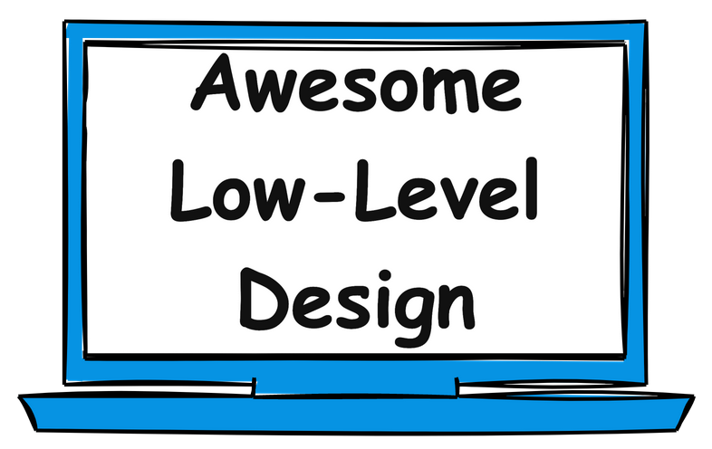

## Images

  

  <a href="https://www.swifttechco.com">Join Free Newsletter</a>

This repository contains resources to learn Low Level Design (LLD) / Object Oriented Design (OOD) and prepare for interviews. It covers OOP fundamentals, design patterns, UML, concurrency and commonly asked interview questions.

## 🏁 Start Here
- [How to Learn LLD](https://www.swifttechco.com)
- [15 Must-Know OOP Concepts](https://www.swifttechco.com)

## 🧱 OOP Fundamentals
- [Classes and Objects](https://www.swifttechco.com)
- [Enums](https://www.swifttechco.com)
- [Interfaces](https://www.swifttechco.com)
- [Encapsulation](https://www.swifttechco.com)
- [Abstraction](https://www.swifttechco.com)
- [Inheritance](https://www.swifttechco.com)
- [Polymorphism](https://www.swifttechco.com)

## 🔗 Class Relationships
- [Association](https://www.swifttechco.com)
- [Aggregation](https://www.swifttechco.com)
- [Composition](https://www.swifttechco.com)
- [Dependency](https://www.swifttechco.com)

## 🧭 Design Principles
- [DRY Principle](https://www.swifttechco.com)
- [YAGNI Principle](https://www.swifttechco.com)
- [KISS Principle](https://www.swifttechco.com)
- [SOLID Principles with Pictures](https://www.swifttechco.com)
- [SOLID Principles with Code](https://www.swifttechco.com)

## 🧩 Design Patterns

| **Creational Patterns**                                                       | **Structural Patterns**                                         | **Behavioral Patterns**                                                               |
| ----------------------------------------------------------------------------- | --------------------------------------------------------------- | ------------------------------------------------------------------------------------- |
| [Singleton](https://www.swifttechco.com)            | [Adapter](https://www.swifttechco.com)     | [Iterator](https://www.swifttechco.com)                         |
| [Factory Method](https://www.swifttechco.com)     | [Bridge](https://www.swifttechco.com)       | [Observer](https://www.swifttechco.com)                         |
| [Abstract Factory](https://www.swifttechco.com) | [Composite](https://www.swifttechco.com) | [Strategy](https://www.swifttechco.com)                         |
| [Builder](https://www.swifttechco.com)                   | [Decorator](https://www.swifttechco.com) | [Command](https://www.swifttechco.com)                           |
| [Prototype](https://www.swifttechco.com)               | [Facade](https://www.swifttechco.com)       | [State](https://www.swifttechco.com)                               |
|                                                                               | [Flyweight](https://www.swifttechco.com) | [Template Method](https://www.swifttechco.com)           |
|                                                                               | [Proxy](https://www.swifttechco.com)         | [Visitor](https://www.swifttechco.com)                           |
|                                                                               |                                                                 | [Mediator](https://www.swifttechco.com)                         |
|                                                                               |                                                                 | [Memento](https://www.swifttechco.com)                           |
|                                                                               |                                                                 | [Chain of Responsibility](https://www.swifttechco.com) |

## 🗂️ UML
- [Class Diagram](https://www.swifttechco.com)
- [Use Case Diagram](https://www.swifttechco.com)
- [Sequence Diagram](https://www.swifttechco.com)
- [Activity Diagram](https://www.swifttechco.com)
- [State Machine Diagram](https://www.swifttechco.com)

## ⏱️ Concurrency and Multi-threading Concepts
### Concurrency 101
- [Introduction to Concurrency](https://www.swifttechco.com)
- [Concurrency vs Parallelism](https://www.swifttechco.com)
- [Processes vs Threads](https://www.swifttechco.com)
- [Thread Lifecycle and States](https://www.swifttechco.com)
- [Race Conditions and Critical Sections](https://www.swifttechco.com)
### Synchronization Primitives
- [Mutex (Mutual Exclusion)](https://www.swifttechco.com)
- [Semaphores](https://www.swifttechco.com)
- [Condition Variables](https://www.swifttechco.com)
- [Coarse-grained vs Fine-grained Locking](https://www.swifttechco.com)
- [Reentrant Locks](https://www.swifttechco.com)
- [Try-Lock and Timed Locking](https://www.swifttechco.com)
- [Compare-and-Swap (CAS)](https://www.swifttechco.com)
### Concurrency Challenges
- [Deadlock](https://www.swifttechco.com)
- [Livelock](https://www.swifttechco.com)
### Concurrency Patterns
- [Signaling Pattern](https://www.swifttechco.com)
- [Thread Pool Pattern](https://www.swifttechco.com)
- [Producer-Consumer Pattern](https://www.swifttechco.com)
- [Reader-Writer Pattern](https://www.swifttechco.com)

## ✅ [How to Answer a LLD Interview Problem](https://www.swifttechco.com)

## 💻 Low Level Design Interview Problems
### Easy Problems

- [Design Parking Lot](problems/parking-lot.md)
- [Design Stack Overflow](problems/stack-overflow.md)
- [Design a Vending Machine](problems/vending-machine.md)
- [Design Logging Framework](problems/logging-framework.md)
- [Design Traffic Signal Control System](problems/traffic-signal.md)
- [Design Coffee Vending Machine](problems/coffee-vending-machine.md)
- [Design a Task Management System](problems/task-management-system.md)

### Medium Problems

- [Design ATM](problems/atm.md)
- [Design LinkedIn](problems/linkedin.md)
- [Design LRU Cache](problems/lru-cache.md)
- [Design Tic Tac Toe Game](problems/tic-tac-toe.md)
- [Design Pub Sub System](problems/pub-sub-system.md)
- [Design an Elevator System](problems/elevator-system.md)
- [Design Car Rental System](problems/car-rental-system.md)
- [Design an Online Auction System](problems/online-auction-system.md)
- [Design Hotel Management System](problems/hotel-management-system.md)
- [Design a Digital Wallet Service](problems/digital-wallet-service.md)
- [Design Airline Management System](problems/airline-management-system.md)
- [Design a Library Management System](problems/library-management-system.md)
- [Design a Social Network like Facebook](problems/social-networking-service.md)
- [Design Restaurant Management System](problems/restaurant-management-system.md)
- [Design a Concert Ticket Booking System](problems/concert-ticket-booking-system.md)

### Hard Problems

- [Design CricInfo](problems/cricinfo.md)
- [Design Splitwise](problems/splitwise.md)
- [Design Chess Game](problems/chess-game.md)
- [Design a Snake and Ladder game](problems/snake-and-ladder.md)
- [Design Ride-Sharing Service like Uber](problems/ride-sharing-service.md)
- [Design Course Registration System](problems/course-registration-system.md)
- [Design Movie Ticket Booking System](problems/movie-ticket-booking-system.md)
- [Design Online Shopping System like Amazon](problems/online-shopping-service.md)
- [Design Online Stock Brokerage System](problems/online-stock-brokerage-system.md)
- [Design Music Streaming Service like Spotify](problems/music-streaming-service.md)
- [Design Online Food Delivery Service like Swiggy](problems/food-delivery-service.md)

## ⏱️ Concurrency and Multi-threading Problems

- [Print FooBar Alternately](https://www.swifttechco.com)
- [Print Zero Even Odd](https://www.swifttechco.com)
- [Fizz Buzz Multithreaded](https://www.swifttechco.com)
- [Building H2O Molecule](https://www.swifttechco.com)
- [Design Thread-Safe Cache with TTL](https://www.swifttechco.com)
- [Design Concurrent HashMap](https://www.swifttechco.com)
- [Design Thread-Safe Blocking Queue](https://www.swifttechco.com)
- [Design Concurrent Bloom Filter](https://www.swifttechco.com)
- [Multi-threaded Merge Sort](https://www.swifttechco.com)

## 📇 Courses
- [Master LLD Interviews - AlgoMaster.io](https://www.swifttechco.com)
- [Master Concurrency Interviews - AlgoMaster.io](https://www.swifttechco.com)

## 📚 Books
- [Head First Design Patterns](https://www.swifttechco.com)
- [Clean Code](https://www.swifttechco.com)
- [Refactoring: Improving the Design of Existing Code](https://www.swifttechco.com)

## 📩 Newsletter
- [AlgoMaster Newsletter](https://www.swifttechco.com)

## Additional resources
- [Coursera - Object-Oriented Design](https://www.swifttechco.com)
- [Coursera - Design Patterns](https://www.swifttechco.com)
- [Github - Awesome Design Patterns](https://www.swifttechco.com)

## 🤝 Contributing
Contributions are welcome! If you'd like to add a new problem, improve existing content, or fix errors:
1. Fork the repository
2. Create a feature branch: `git checkout -b feature/your-feature-name`
3. Commit your changes: `git commit -m 'Add some feature'`
4. Push to the branch: `git push origin feature/your-feature-name`
5. Submit a pull request

Please make sure to update Readme files and documentation as appropriate.

---

---

## Swift Tech Co.

Built and maintained by Swift Tech Co.

AI Automation | FinTech Platforms | Custom Software and Mobile Apps | SaaS Platforms | Cloud Infrastructure | Cybersecurity | SEO and Marketing | API Integration

**Join our community on Telegram:** [t.me/+Qt_eFvkb2rliMzNh](https://t.me/+Qt_eFvkb2rliMzNh)

[Home](https://www.swifttechco.com) | [Services](https://www.swifttechco.com/services) | [Careers](https://www.swifttechco.com/careers) | [Referral Program](https://www.swifttechco.com/referral) | [Influencers](https://www.swifttechco.com/influencers) | [About](https://www.swifttechco.com/about) | [Contact](https://www.swifttechco.com/contact)

**Connect**

- Website: [swifttechco.com](https://www.swifttechco.com)
- LinkedIn: [linkedin.com/in/stephenoladoke](https://www.linkedin.com/in/stephenoladoke/)
- LinkedIn (Company): [linkedin.com/company/swift-tech-co](https://www.linkedin.com/company/swift-tech-co)
- X: [@MrOladoke](https://x.com/MrOladoke)
- Instagram: [@mr.oladoke](https://www.instagram.com/mr.oladoke/)
- Instagram (Company): [@swifttechco](https://www.instagram.com/swifttechco/)
- Organization: [github.com/Swift-Tech-Co](https://github.com/Swift-Tech-Co)
