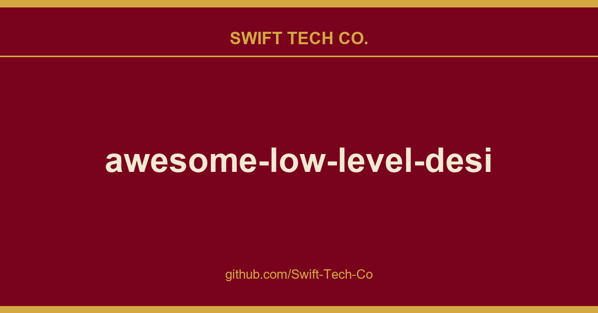
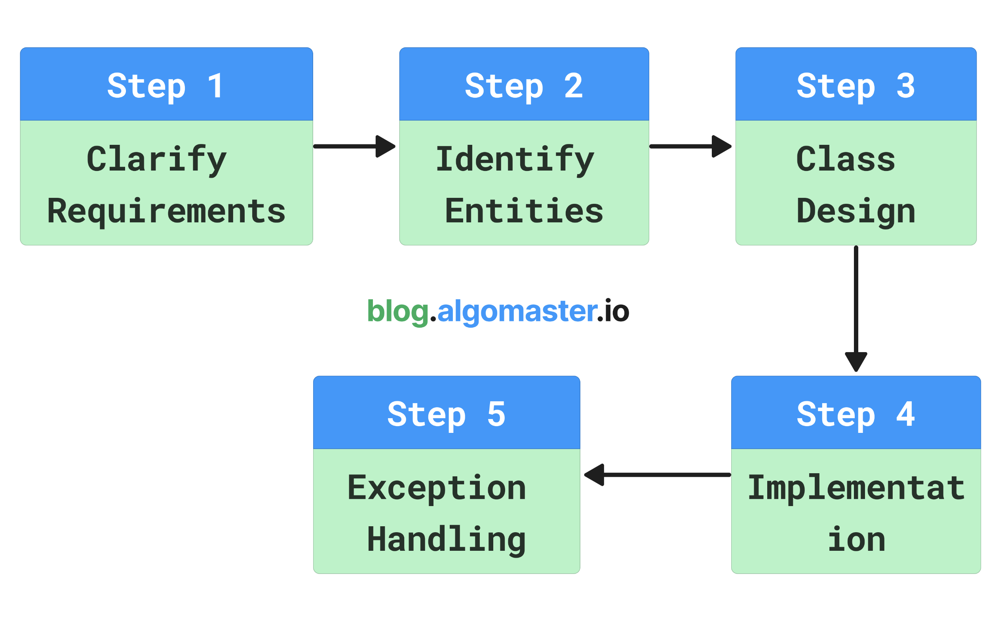

# awesome-low-level-design

## What This Is

This is part of the Swift Tech Co. working stack for product and engineering. It gathers the awesome-low-level-design notes, examples and fixes that keep delivery fast, and doubles as the reference map we hand to whoever picks up this thread next.

## Images

## 🏁 Start Here
- How to Learn LLD
- 15 Must-Know OOP Concepts

## 🧱 OOP Fundamentals
- Classes and Objects
- Enums
- Interfaces
- Encapsulation
- Abstraction
- Inheritance
- Polymorphism

## 🔗 Class Relationships
- Association
- Aggregation
- Composition
- Dependency

## 🧭 Design Principles
- DRY Principle
- YAGNI Principle
- KISS Principle
- SOLID Principles with Pictures
- SOLID Principles with Code

## 🧩 Design Patterns

| **Creational Patterns**                                                       | **Structural Patterns**                                         | **Behavioral Patterns**                                                               |
| ----------------------------------------------------------------------------- | --------------------------------------------------------------- | ------------------------------------------------------------------------------------- |
| Singleton            | Adapter     | Iterator                         |
| Factory Method     | Bridge       | Observer                         |
| Abstract Factory | Composite | Strategy                         |
| Builder                   | Decorator | Command                           |
| Prototype               | Facade       | State                               |
|                                                                               | Flyweight | Template Method           |
|                                                                               | Proxy         | Visitor                           |
|                                                                               |                                                                 | Mediator                         |
|                                                                               |                                                                 | Memento                           |
|                                                                               |                                                                 | Chain of Responsibility |

## 🗂️ UML
- Class Diagram
- Use Case Diagram
- Sequence Diagram
- Activity Diagram
- State Machine Diagram

## ⏱️ Concurrency and Multi-threading Concepts
### Concurrency 101
- Introduction to Concurrency
- Concurrency vs Parallelism
- Processes vs Threads
- Thread Lifecycle and States
- Race Conditions and Critical Sections
### Synchronization Primitives
- Mutex (Mutual Exclusion)
- Semaphores
- Condition Variables
- Coarse-grained vs Fine-grained Locking
- Reentrant Locks
- Try-Lock and Timed Locking
- Compare-and-Swap (CAS)
### Concurrency Challenges
- Deadlock
- Livelock
### Concurrency Patterns
- Signaling Pattern
- Thread Pool Pattern
- Producer-Consumer Pattern
- Reader-Writer Pattern

## ✅ How to Answer a LLD Interview Problem

## 💻 Low Level Design Interview Problems
### Easy Problems

- [Design Parking Lot](problems/parking-lot.md)
- [Design Stack Overflow](problems/stack-overflow.md)
- [Design a Vending Machine](problems/vending-machine.md)
- [Design Logging Framework](problems/logging-framework.md)
- [Design Traffic Signal Control System](problems/traffic-signal.md)
- [Design Coffee Vending Machine](problems/coffee-vending-machine.md)
- [Design a Task Management System](problems/task-management-system.md)

### Medium Problems

- [Design ATM](problems/atm.md)
- [Design LinkedIn](problems/linkedin.md)
- [Design LRU Cache](problems/lru-cache.md)
- [Design Tic Tac Toe Game](problems/tic-tac-toe.md)
- [Design Pub Sub System](problems/pub-sub-system.md)
- [Design an Elevator System](problems/elevator-system.md)
- [Design Car Rental System](problems/car-rental-system.md)
- [Design an Online Auction System](problems/online-auction-system.md)
- [Design Hotel Management System](problems/hotel-management-system.md)
- [Design a Digital Wallet Service](problems/digital-wallet-service.md)
- [Design Airline Management System](problems/airline-management-system.md)
- [Design a Library Management System](problems/library-management-system.md)
- [Design a Social Network like Facebook](problems/social-networking-service.md)
- [Design Restaurant Management System](problems/restaurant-management-system.md)
- [Design a Concert Ticket Booking System](problems/concert-ticket-booking-system.md)

### Hard Problems

- [Design CricInfo](problems/cricinfo.md)
- [Design Splitwise](problems/splitwise.md)
- [Design Chess Game](problems/chess-game.md)
- [Design a Snake and Ladder game](problems/snake-and-ladder.md)
- [Design Ride-Sharing Service like Uber](problems/ride-sharing-service.md)
- [Design Course Registration System](problems/course-registration-system.md)
- [Design Movie Ticket Booking System](problems/movie-ticket-booking-system.md)
- [Design Online Shopping System like Amazon](problems/online-shopping-service.md)
- [Design Online Stock Brokerage System](problems/online-stock-brokerage-system.md)
- [Design Music Streaming Service like Spotify](problems/music-streaming-service.md)
- [Design Online Food Delivery Service like Swiggy](problems/food-delivery-service.md)

## ⏱️ Concurrency and Multi-threading Problems

- Print FooBar Alternately
- Print Zero Even Odd
- Fizz Buzz Multithreaded
- Building H2O Molecule
- Design Thread-Safe Cache with TTL
- Design Concurrent HashMap
- Design Thread-Safe Blocking Queue
- Design Concurrent Bloom Filter
- Multi-threaded Merge Sort

## 📇 Courses
- Master LLD Interviews - AlgoMaster.io
- Master Concurrency Interviews - AlgoMaster.io

## 📚 Books
- Head First Design Patterns
- Clean Code
- Refactoring: Improving the Design of Existing Code

## 📩 Newsletter
- AlgoMaster Newsletter

## Additional resources
- Coursera - Object-Oriented Design
- Coursera - Design Patterns
- Github - Awesome Design Patterns

## 🤝 Contributing
Contributions are welcome! If you'd like to add a new problem, improve existing content, or fix errors:
1. Fork the repository
2. Create a feature branch: `git checkout -b feature/your-feature-name`
3. Commit your changes: `git commit -m 'Add some feature'`
4. Push to the branch: `git push origin feature/your-feature-name`
5. Submit a pull request

Please make sure to update Readme files and documentation as appropriate.

---

---

## Swift Tech Co.

Built and maintained by Swift Tech Co.

AI Automation | FinTech Platforms | Custom Software and Mobile Apps | SaaS Platforms | Cloud Infrastructure | Cybersecurity | SEO and Marketing | API Integration

**Join our community on Telegram:** [t.me/+Qt_eFvkb2rliMzNh](https://t.me/+Qt_eFvkb2rliMzNh)

Home | Services | Careers | Referral Program | Influencers | About | Contact

**Connect**

- Website: https://github.com/Swift-Tech-Co/awesome-low-level-design
- LinkedIn: [linkedin.com/in/stephenoladoke](https://www.linkedin.com/in/stephenoladoke/)
- LinkedIn (Company): [linkedin.com/company/swift-tech-co](https://www.linkedin.com/company/swift-tech-co)
- X: [@MrOladoke](https://x.com/MrOladoke)
- Instagram: [@mr.oladoke](https://www.instagram.com/mr.oladoke/)
- Organization: [github.com/Swift-Tech-Co](https://github.com/Swift-Tech-Co)

## Sources

Compiled and maintained from upstream [ashishps1/awesome-low-level-design](https://github.com/ashishps1/awesome-low-level-design) under permissive open-source license.

---

Maintained by [Swift Tech Co.](https://github.com/Swift-Tech-Co) - [Telegram](https://t.me/+Qt_eFvkb2rliMzNh)

## Sources

Compiled and maintained from upstream [ashishps1/awesome-low-level-design](https://github.com/ashishps1/awesome-low-level-design) under permissive open-source license.

---

Maintained by [Swift Tech Co.](https://github.com/Swift-Tech-Co) - [Telegram](https://t.me/+Qt_eFvkb2rliMzNh)

## Sources

Compiled and maintained from upstream [ashishps1/awesome-low-level-design](https://github.com/ashishps1/awesome-low-level-design) under permissive open-source license.

---

Maintained by [Swift Tech Co.](https://github.com/Swift-Tech-Co) - [Telegram](https://t.me/+Qt_eFvkb2rliMzNh)

## Sources

Compiled and maintained from upstream [ashishps1/awesome-low-level-design](https://github.com/ashishps1/awesome-low-level-design) under permissive open-source license.

---

Maintained by [Swift Tech Co.](https://github.com/Swift-Tech-Co) - [Telegram](https://t.me/+Qt_eFvkb2rliMzNh)

## Sources

Compiled and maintained from upstream [ashishps1/awesome-low-level-design](https://github.com/ashishps1/awesome-low-level-design) under permissive open-source license.

---

Maintained by [Swift Tech Co.](https://github.com/Swift-Tech-Co) - [Telegram](https://t.me/+Qt_eFvkb2rliMzNh)